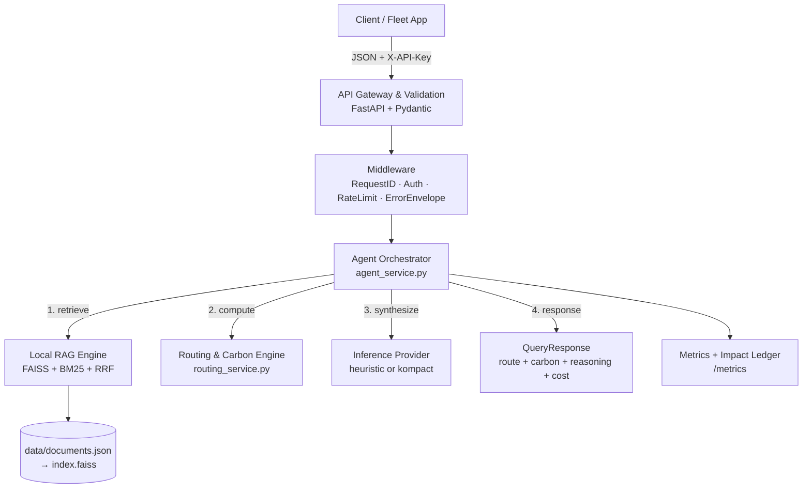

# EcoRoute AI

**Privacy-first, CPU-native sustainable route optimization with local RAG.**

EcoRoute AI answers fleet routing queries by retrieving localized emission
guidelines from an on-device knowledge base, computing per-route carbon with a
deterministic physical model, and returning citation-backed reasoning — all on
CPU, with no data leaving the host. Built for the **ZIROH Build Next 2026**
sustainable-AI challenge: ultra-fast, secure, and cost-effective inference on
edge and cloud infrastructure.

---

## Why this wins on the challenge criteria

| Criterion | How EcoRoute delivers |
|---|---|
| **Sustainability** | Every response reports `kg CO2e saved`; a durable SQLite ledger (`/v1/impact`) keeps the cumulative total across restarts. The carbon model is grounded in real emission norms (BS-VI, Euro VI). |
| **Cost-effectiveness** | Each query returns a `compute_cost` breakdown; `/v1/cost-comparison` projects it at scale — **₹0.01 vs ₹498 per 10k queries** (median of 3 runs), i.e. orders of magnitude cheaper than a cloud LLM API. |
| **Efficiency** | CPU-only, no GPU. Persisted FAISS index + model warmup → fast first query. Hybrid dense+BM25 retrieval in-process. Measured **~82 req/s, p95 155 ms** on a single worker. |
| **Security / Privacy** | Data never leaves the host (local RAG, no external API calls). API-key auth, rate limiting, payload bounds, non-root container, `pip-audit` in CI. |
| **Demo-ability** | Clickable web UI at `/`, one-command fleet demo, and a 3-minute pitch script with judge Q&A. |
| **Kompact AI readiness** | Inference is behind an `InferenceProvider` protocol. Swap `heuristic` → `kompact` with one env var; the Phase-2 runtime drops in with zero upstream changes. |

---

## Architecture



### Request flow
1. **Retrieve** — hybrid dense (MiniLM + FAISS) + sparse (BM25) search, fused with Reciprocal Rank Fusion, over local emission guidelines.
2. **Compute** — resolve distance (explicit → real Haversine × road-factor for known cities → deterministic fallback), generate 3 candidate routes (direct / off-peak eco / consolidated); carbon = `distance × payload-adjusted factor + idle_hours × 3.2 kg/h`.
3. **Select** — recommend the lowest-carbon route; baseline = highest-carbon alternative.
4. **Synthesize** — citation-backed reasoning via the pluggable inference provider.
5. **Report** — attach compute-cost + energy breakdown; update the impact ledger.

> **Geographic distances:** `data/cities.json` holds lat/lon for 30 Indian cities.
> Known city pairs use real Haversine distance × 1.2 road factor (e.g. Delhi→Jaipur ≈ 282 km).
> Unknown pairs fall back to a deterministic estimate, and clients may always pass an explicit `distance_km`.

---

## Project structure

```
Build_Hackathon/
├── main.py                     # Entry point, lifespan wiring, middleware
├── api/
│   ├── routes.py               # /v1/optimize-route, /health, /ready, /metrics, /v1/knowledge-base
│   ├── schemas.py              # Pydantic models (strict validation, bounded fields)
│   └── middleware.py           # RequestID, Auth, RateLimit, ErrorEnvelope
├── core/
│   ├── config.py               # pydantic-settings typed config (fail-fast)
│   ├── logger.py               # Structured JSON logging + request-id correlation
│   └── inference.py            # InferenceProvider protocol (heuristic | kompact)
├── services/
│   ├── rag_service.py          # FAISS + BM25 + RRF, index persistence, degradation
│   ├── routing_service.py      # Deterministic carbon model + candidate generation
│   ├── agent_service.py        # Orchestrator: RAG → routing → inference → cost
│   ├── metrics.py              # Prometheus metrics + in-memory counters
│   └── ledger.py               # Persistent carbon-impact ledger (SQLite)
├── data/
│   ├── documents.json          # 16 real emission/regulation/guideline documents
│   ├── cities.json             # lat/lon for 30 Indian cities (Haversine distances)
│   └── ledger.db               # Persistent carbon-impact ledger (SQLite, auto-created)
├── scripts/
│   ├── build_index.py          # Build persisted FAISS index + chunks
│   ├── load_test.py            # Concurrent load test (stdlib, no locust)
│   ├── retrieval_report.py     # recall@k / MRR / precision@k over golden set
│   └── make_demo_video.py      # Playwright screen-recording of the web UI
├── demo/
│   └── run_demo.py             # One-command fleet scenario demo
├── docs/
│   └── DEMO_SCRIPT.md          # 3-min pitch script + judge Q&A
├── static/
│   └── index.html              # Web UI dashboard (served at /)
├── tests/
│   ├── test_routing.py         # Carbon math + geographic distance edge cases
│   ├── test_rag.py             # Chunking, BM25, determinism
│   ├── test_rag_dense.py       # FAISS+MiniLM hybrid path (skips if no index)
│   ├── test_api.py             # API integration (TestClient)
│   ├── test_core.py            # config, logger, metrics, inference
│   ├── test_middleware.py      # auth, rate-limit, request-id, error envelope
│   ├── test_schemas.py         # Pydantic validation bounds
│   ├── test_ledger.py          # Persistent ledger record/totals
│   └── eval/test_retrieval_quality.py  # recall@k on golden queries
├── .github/workflows/ci.yml    # ruff → mypy → pytest → pip-audit → docker build
├── Dockerfile                  # Multi-stage, non-root, index built at build time
├── Makefile                    # make install / index / dev / test / docker / demo
└── pyproject.toml              # Deps + ruff/mypy/pytest config
```

---

## Quick start

```bash
# 1. Create env + install
make install

# 2. Build the RAG index (downloads MiniLM once, ~90MB)
make index

# 3. Run the API
make dev
# → http://localhost:8000  (docs at /docs)
```

### Try it

```bash
curl -s http://localhost:8000/v1/optimize-route \
  -H "Content-Type: application/json" \
  -H "X-API-Key: dev-key-123" \
  -d '{
    "origin": "Delhi",
    "destination": "Jaipur",
    "vehicle_type": "heavy_truck",
    "payload_kg": 20000
  }' | python -m json.tool
```

### Run the demo

```bash
make demo
```

For the full 3-minute pitch (slide-by-slide script + judge Q&A), see
[`docs/DEMO_SCRIPT.md`](docs/DEMO_SCRIPT.md).

### Docker

```bash
make docker
docker run -p 8000:8000 -e API_KEYS=dev-key-123 ecoroute-ai:latest
```

---

## API

| Method | Path | Auth | Description |
|---|---|---|---|
| POST | `/v1/optimize-route` | yes | Core routing + carbon + reasoning |
| GET | `/v1/cost-comparison?queries=N` | yes | CPU-vs-cloud cost projection (the money shot) |
| GET | `/health` | no | Liveness |
| GET | `/ready` | no | Readiness (verifies index loaded) |
| GET | `/metrics` | no | Prometheus metrics + impact ledger |
| GET | `/v1/knowledge-base` | yes | Inspect the local KB (docs, chunks, categories) |

### `GET /v1/cost-comparison?queries=10000`

Projects the cost of N requests on the local CPU stack vs a cloud LLM API,
using a real measured per-query CPU time.

```json
{
  "queries": 10000,
  "per_query": { "cpu_seconds": 0.012, "local_cost_inr": 2e-06, "cloud_llm_cost_usd": 0.0006 },
  "total": {
    "local_cost_inr": 0.02,
    "cloud_llm_cost_usd": 6.0,
    "cloud_llm_cost_inr": 498.0,
    "savings_inr": 497.98,
    "cloud_is_x_times_more_expensive": 24900.0
  },
  "assumptions": { "cpu_watts": 65.0, "energy_cost_inr_per_kwh": 9.0, "usd_to_inr": 83.0 }
}
```

### `POST /v1/optimize-route`

**Request**
```json
{
  "origin": "Delhi",
  "destination": "Jaipur",
  "vehicle_type": "heavy_truck",
  "payload_kg": 20000,
  "distance_km": null,
  "constraints": { "avoid_highways": false }
}
```
`vehicle_type`: `light_truck` | `medium_truck` | `heavy_truck` | `electric_van` | `cng_truck`

**Response**
```json
{
  "status": "ok",
  "request_id": "a1b2c3d4e5f6",
  "recommended_route": {
    "route_id": "route-1f2e3d4c",
    "description": "Off-peak eco route Delhi -> Jaipur, departs outside congestion windows",
    "distance_km": 296.4,
    "estimated_time_min": 323.3,
    "carbon_kg": 287.1,
    "is_recommended": true
  },
  "alternatives": [ { "route_id": "route-...", "is_recommended": false } ],
  "estimated_carbon_saved_kg": 41.2,
  "baseline_carbon_kg": 328.3,
  "reasoning_steps": [
    { "step": 1, "action": "retrieve_context", "detail": "...", "sources": ["doc-heavy-truck-emission-factor#0"] }
  ],
  "rag_context": [ "A typical 40-ton heavy-duty diesel truck emits..." ],
  "compute_cost": {
    "cpu_seconds": 0.042,
    "energy_kwh": 0.00000077,
    "estimated_cost_inr": 0.0000069,
    "cloud_llm_equivalent_cost_usd": 0.0006,
    "savings_vs_cloud_inr": 0.049
  },
  "degraded": false
}
```

---

## Configuration

All settings via environment (see `.env.example`). Key toggles:

| Var | Default | Purpose |
|---|---|---|
| `API_KEYS` | *(empty = auth off)* | Comma-separated keys; enables auth when set |
| `RATE_LIMIT_PER_MINUTE` | `60` | Per-key sliding-window limit |
| `INFERENCE_PROVIDER` | `heuristic` | `heuristic` or `kompact` (Phase 2) |
| `EMBEDDING_MODEL` | `all-MiniLM-L6-v2` | Sentence-transformers model |
| `RAG_TOP_K` | `3` | Retrieval depth |
| `LOG_LEVEL` | `INFO` | DEBUG/INFO/WARNING/ERROR |

---

## Testing & quality

```bash
make test        # 77 tests: routing, geo-distance, RAG (BM25+dense), API, core, middleware, schemas, ledger, retrieval eval
make lint        # ruff
make typecheck   # mypy
make audit       # pip-audit (CVE scan)
```

The fast suite runs **offline** (BM25 mode) so CI is quick and deterministic.
The dense FAISS tests auto-skip unless the index is built (`make index`). The
retrieval eval asserts recall@3 on 8 golden queries.

---

## Phase 2: Kompact AI Runtime

The inference layer is fully decoupled behind `core/inference.py`:

```python
class InferenceProvider(Protocol):
    name: str
    def synthesize(self, prompt: str, context: list[str]) -> InferenceResult: ...
```

- `HeuristicProvider` — deterministic, zero-model (default).
- `KompactProvider` — stub mirroring the runtime interface; implement `_infer()`
  against the provisioned Kompact endpoint.

Switch with `INFERENCE_PROVIDER=kompact`. No changes to the agent, API, or RAG.

---

## Design decisions (production-grade)

- **Fail-fast config** — `pydantic-settings` validates the environment at boot.
- **No event-loop blocking** — CPU work in sync handlers → threadpool.
- **Fast, deterministic boot** — persisted FAISS index; no re-embedding at startup.
- **Graceful degradation** — if the embedding model is unavailable, RAG falls back to BM25 and flags `degraded: true` instead of failing.
- **Observability** — structured JSON logs with request-id correlation, Prometheus `/metrics`, liveness + readiness probes.
- **Security** — API-key auth, rate limiting, bounded payloads, non-root container, dependency CVE scanning in CI.
- **Reproducibility** — deterministic routing (hash-based distance), seeded-free math, exact pinned deps.
